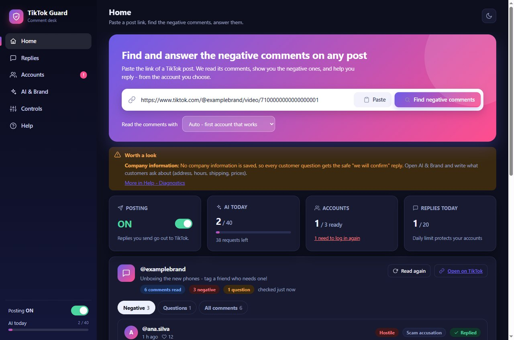
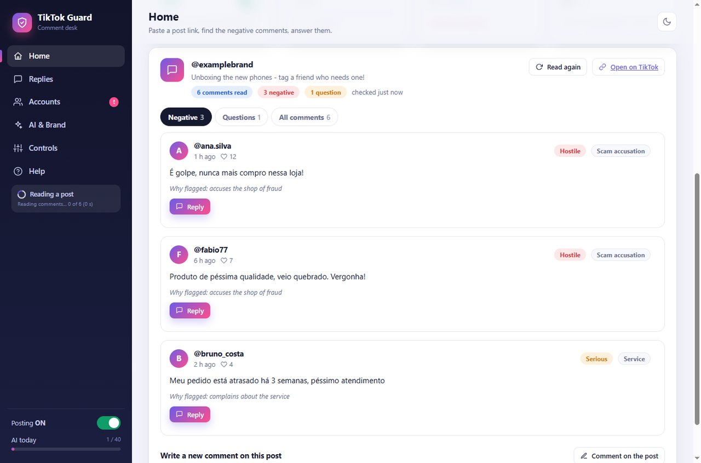
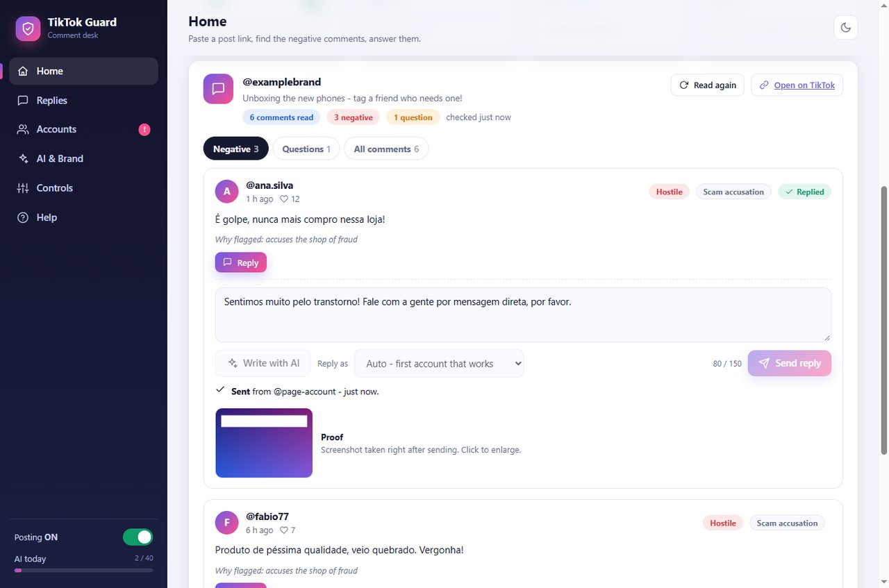
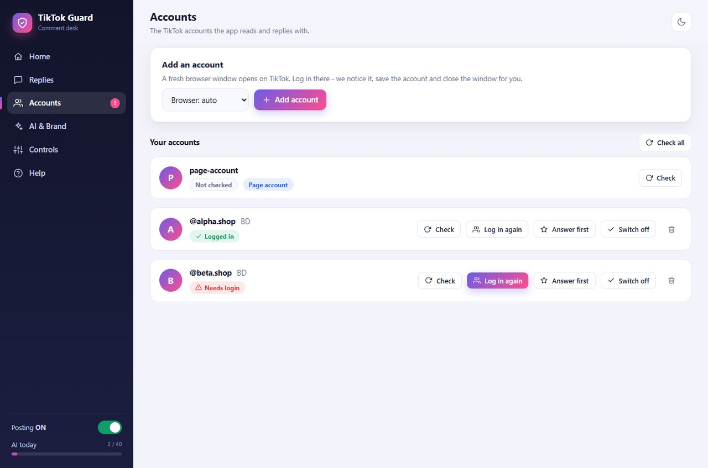
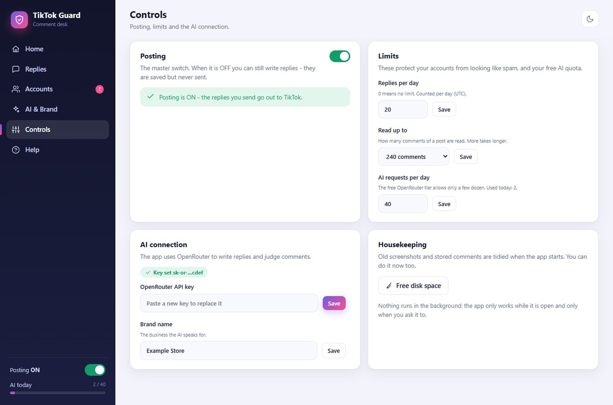
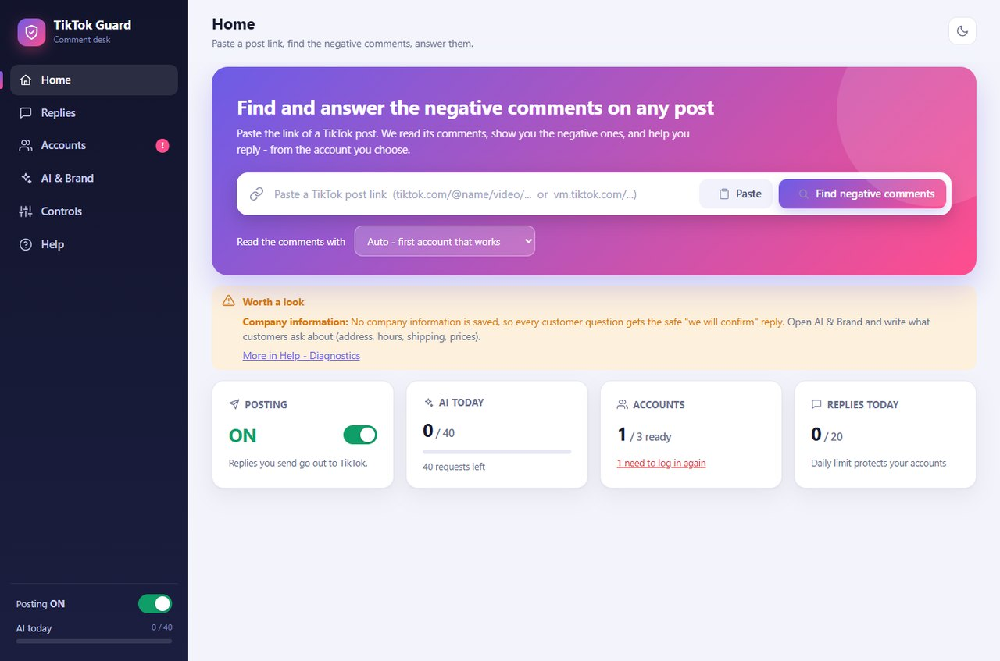
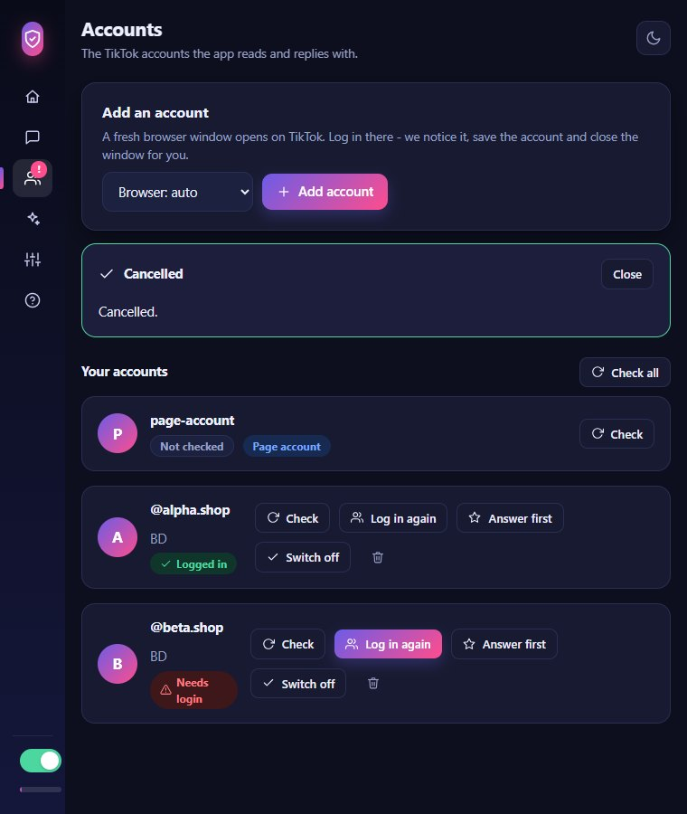
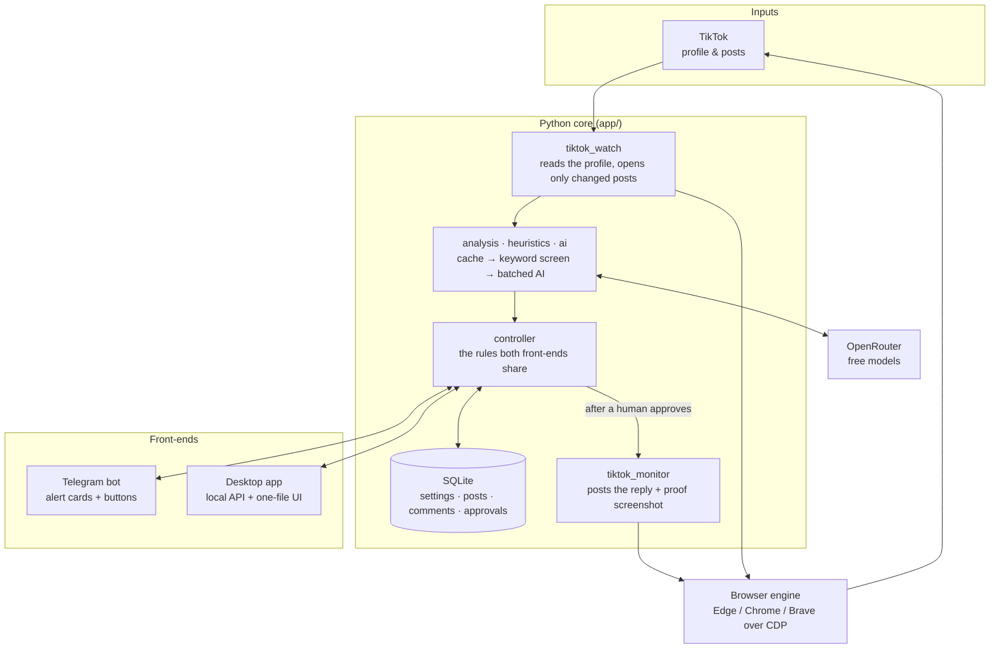

<p align="center">
  
</p>

<h1 align="center">TikTok Guard</h1>

<p align="center">
  <b>Finds the negative comments and customer questions on a brand's TikTok posts, drafts the right reply with AI —<br>
  and posts it only after a human says yes.</b><br>
  A Windows desktop app <i>and</i> a 24/7 Telegram-bot service, from one Python code base.
</p>

<p align="center">
  
  
  
  
  
  
  
</p>

<p align="center">
  
</p>

---

## 💡 What it does

A brand's TikTok page collects hundreds of comments. A few of them are complaints that need an answer today, and some are
simple questions that cost a sale if nobody replies. TikTok Guard turns that pile into a short, prioritised list.

```text
   WATCH  →   JUDGE   →   DRAFT    →   APPROVE   →   REPLY  →   PROOF
 new comments  negative?   AI answer    a human taps    posted     screenshot of
 on the posts  question?   in the       the button      from the   the reply, right
 you follow    how bad?    comment's                    chosen     under the card
                           language                     account
```

- It **reads** a post's comments, and an AI marks the **negative** ones and the **customer questions**, with the reason and a severity.
- It **drafts a reply in the language of the comment** (Portuguese, Spanish, English, Polish, …) in the brand's tone, using only the facts
  the owner has saved — and says *"we'll confirm that"* instead of inventing an answer.
- **Nothing is posted without a human tap.** After sending, it shows a **proof screenshot** of the reply.

> All brand names, accounts, comments and numbers in the screenshots, samples and tests of this repository are made up.

---

## 📸 Screenshots

<table>
  <tr>
    <td width="50%"></td>
    <td width="50%"></td>
  </tr>
  <tr>
    <td align="center"><sub><b>Review</b> — negative comments first, with severity, category and <i>why it was flagged</i></sub></td>
    <td align="center"><sub><b>Reply</b> — AI draft or your own text, choose the account, send, and get the proof</sub></td>
  </tr>
  <tr>
    <td width="50%"></td>
    <td width="50%"></td>
  </tr>
  <tr>
    <td align="center"><sub><b>Accounts</b> — log in through a real browser window; health, order and "answer first"</sub></td>
    <td align="center"><sub><b>Controls</b> — master posting switch, daily limits, AI connection</sub></td>
  </tr>
</table>

<table>
  <tr>
    <td width="60%"></td>
    <td width="40%"></td>
  </tr>
  <tr>
    <td align="center"><sub>Light theme</sub></td>
    <td align="center"><sub>Responsive: the sidebar collapses in a narrow window</sub></td>
  </tr>
</table>

---

## 🧩 Two ways to run it

| | **Desktop app** | **Telegram bot service** |
| --- | --- | --- |
| For | A person at a PC | A server that never sleeps |
| How | Paste the link of *any* post and press **Find negative comments** | Watches the profile **every 2 minutes** by itself |
| Alerts | On screen | A Telegram card with full details, a suggested reply and buttons **✅ Post · ✏️ Edit · 🔄 Regenerate · 🚫 Ignore** |
| Package | One-click Windows installer, no Python needed | `python run.py serve` — systemd unit (Linux) or NSSM service (Windows) |

Both use the same engine, database and rules (`app/controller.py`), so a reply behaves exactly the same on either side.

---

## 🧠 Engineering highlights

**AI that is cheap, honest and safe**
- **A comment costs AI budget at most once, usually never**: already-seen comments are skipped, identical texts share one verdict, emoji and
  short praise are screened by keywords for free, and the rest goes in **batches of 12 per request**. A daily cap is checked *before* every
  request, and a free-tier rate limit parks the AI instead of hammering it.
- **It cannot make facts up.** The model must answer `UNKNOWN` when the company information doesn't contain the answer, and a **number check**
  rejects any reply that contains a year, price or time that isn't in the supplied text. In both cases the customer gets a polite standard
  reply that points to a direct message.
- **Replies are in the comment's language.** The AI labels each comment's language, and an offline detector (`app/lang.py`) double-checks it
  from alphabet and typical words, so a mislabelled comment still gets the right language.

**Built so a person stays in control**
- Human approval for every post, a master **Posting ON/OFF** switch, a daily reply cap, a minimum gap between posts, one open card per target,
  a 150-character limit, and a warning on the card when the same target was already commented on recently.
- **Crash-safe sending.** If the app is killed mid-send, the card is found at the next start as *"Check on TikTok"* — it is never left spinning and
  **never re-sent automatically**; a button re-reads the post and decides *Sent / Maybe sent / Not sent*.
- Only the configured Telegram chat is obeyed; secrets are masked in logs; the app never asks for or stores a TikTok password — logins live in
  the browser's own profile folder, and the bot **refuses to touch an everyday browser profile**.

**Resilient with the real world**
- TikTok limits how often a profile page may be opened, so a post is opened only when its **comment count changed**, accounts that just met a wall
  go to the back of the queue, and after a security check the app **backs off 5 → 10 → 20 → 40 → 60 minutes**.
- A **memory guard** skips a browser launch when the machine is short on RAM; a watchdog closes a browser job stuck for 15 minutes; leftover
  browsers from a killed run are cleaned at start.

**Production-grade plumbing**
- **SQLite (WAL)** with retention windows per data type, a size cap, incremental vacuum and a **daily integrity-checked backup**.
- A **local HTTP API** (`docs/API.md`, ~50 endpoints, token-protected, `127.0.0.1` only) that the desktop UI is a thin client of; the UI is a single
  HTML file with no external scripts or fonts and renders text with `textContent` only.
- **Windows installer pipeline** — PyInstaller one-folder build → secret scan of the build → exe tests → Inno Setup installer → installer tests
  that really install, upgrade and uninstall. Per-user install, no admin rights; the build scanner fails if a key or token is inside.
- **Deployment kit** — a hardened systemd unit (`Nice`, `CPUQuota`, `MemoryMax`), an NSSM service script, and a deployment *bundle* built from an
  explicit allow-list and re-verified with `verify-bundle`.

---

## 🏗️ Architecture



---

## ✅ Testing

**699 automated tests, all offline** — no TikTok, no Telegram, no real AI. The suite runs the whole product against a *fake world*:
a fake TikTok, a fake poster, throw-away databases.

- **73 UI tests drive the real desktop screen in a headless browser** against that fake TikTok (every page, every state: sending, failed, held, narrow window).
- On top of the 699, the Windows build chain runs `buildexe/test_exe.py` and `buildexe/test_installer.py` against the *built* files: they start the
  packaged app, **install the Setup for real**, check that no secret or dev-machine path leaked in, upgrade, and uninstall again.
- `tests/ui_screens.py` renders every screen (light + dark) — the screenshots above came from it.

---

## 📁 Project structure

```text
TikTok-Guard/
├── app.py                 desktop launcher        (python app.py)
├── run.py                 CLI & the 24/7 service  (python run.py serve)
├── config.py              every setting, read from .env
├── app/
│   ├── controller.py      business rules shared by Telegram and desktop
│   ├── tiktok_watch.py    profile scan
│   ├── tiktok_monitor.py  reading comments & posting replies
│   ├── ai.py · analysis.py · heuristics.py · lang.py · context.py   the AI pipeline and its guards
│   ├── service.py · bot.py · notifier.py                            Telegram side
│   ├── desktop.py · api.py · web/desktop.html                       desktop side
│   ├── accounts.py · account_manager.py · browsers.py               accounts & browser handling
│   ├── db.py · maintenance.py · backup.py                           storage
│   └── deploy.py · health.py · selftest.py · launcher.py            packaging, checks, startup
├── buildexe/              PyInstaller spec, Inno Setup script, build + exe/installer tests
├── deploy/                systemd unit and Linux / Windows install scripts
├── tests/                 699 offline tests + the fake world
└── docs/                  API.md (local API) · DETAILS.md (the full manual)
```

---

## 🚀 Running it

Requires Python 3.11+ and one of Edge / Chrome / Brave installed.

```bash
git clone https://github.com/shizan52/TikTok-Guard.git
cd TikTok-Guard
pip install -r requirements.txt      # Playwright is used only as a CDP client — no browser is downloaded
cp .env.example .env                 # then fill in your own keys (never commit .env)

python app.py                        # the desktop app
python run.py serve                  # the monitoring service + Telegram bot
python -W ignore -m unittest discover -s tests      # the test suite
```

> **Scope of this repository.** The browser-automation engine (`bfp`) is a separate module and is **not included here**. Put it in `vendor/` or point
> `BFP_PATH` at it; without it the code cannot start a browser, and the tests that import it cannot run. Everything else — the AI pipeline, rules,
> storage, local API, desktop UI, tests, installer and deployment scripts — is in this repository. The full manual is in [docs/DETAILS.md](docs/DETAILS.md).

---

## ⚠️ Disclaimer

TikTok Guard is an independent project and is **not affiliated with, endorsed by, or connected to TikTok or ByteDance**. It automates a normal
web browser, which may conflict with the terms of the platform — use it only with accounts you own or are authorised to manage, and at your own
risk. By design it never posts without a person's explicit approval and it limits how often it posts.

---

## 👤 Author

**Tayb Hassan Shizan** — [github.com/shizan52](https://github.com/shizan52)

<p align="center"><sub>© 2026 Tayb Hassan Shizan. All rights reserved. The source is shared for portfolio and review purposes.</sub></p>
